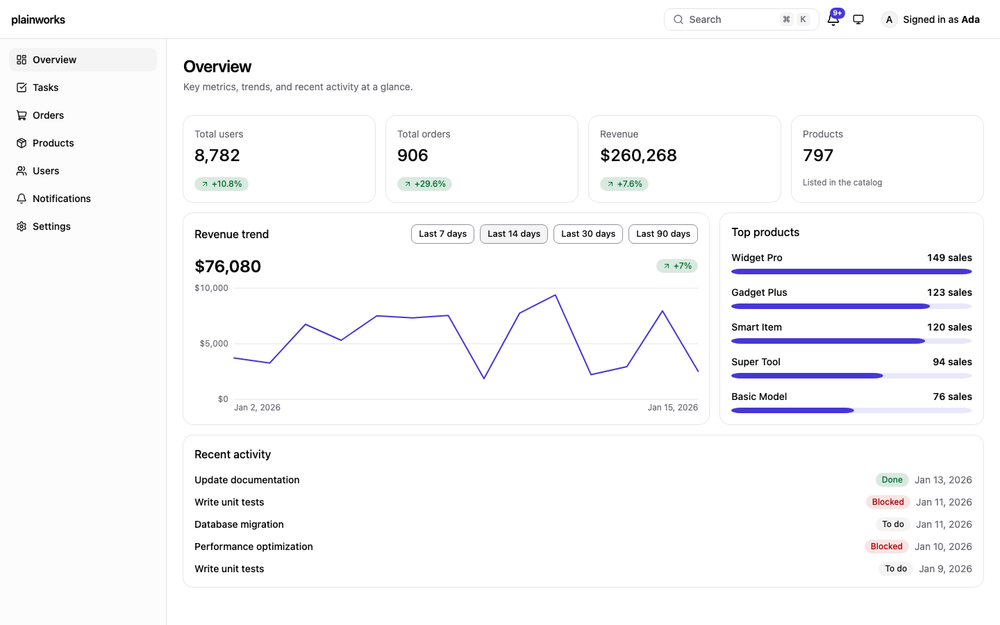
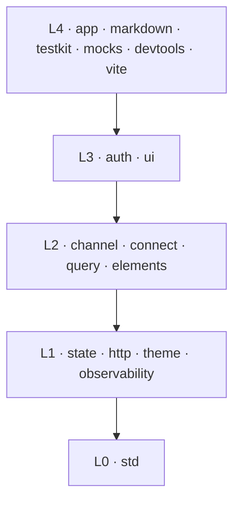

# plainworks

> A foundational, **host-independent** React and TypeScript kit with runtime-neutral cores and optional client bindings.

## Status

plainworks is **alpha** (`0.1.0-alpha.x`) and not yet published to npm. APIs change freely until the stable release; breaking changes are listed in each package's changelog. Only the latest line receives [security fixes](./SECURITY.md#supported-versions).

## Run the showcase

Run the workspace showcase to see the current packages work together through their public exports:

```sh
bun install
bun run --filter @plainworks/showcase dev
```

The showcase server-renders a task dashboard, hydrates it on the client, reads data through the query and HTTP packages, applies the theme before paint, and routes live events into state and cache updates.

<picture>
  <source media="(prefers-color-scheme: dark)" srcset="apps/showcase/docs/images/overview-dark.png">
  
</picture>

A second reference host, [`@plainworks/next-host`](./apps/next-host), assembles the same packages under Next.js App Router and React Server Components. Two genuinely different hosts on one kit is the proof of host-independence.

## Choose a package

| Need | Package |
|---|---|
| Errors, results, guards, resilience, and shared contracts | [`@plainworks/std`](./packages/std) |
| Reactive state with optional React bindings | [`@plainworks/state`](./packages/state) |
| Typed HTTP requests and list-query serialization | [`@plainworks/http`](./packages/http) |
| Theme tokens, schemes, and runtime resolution | [`@plainworks/theme`](./packages/theme) |
| Structured logging, error reporting, telemetry, and Web Vitals | [`@plainworks/observability`](./packages/observability) |
| SSE and WebSocket channels | [`@plainworks/channel`](./packages/channel) |
| Connect RPC clients and interceptors | [`@plainworks/connect`](./packages/connect) |
| TanStack Query factories and cache integration | [`@plainworks/query`](./packages/query) |
| Vendored, locked Base UI and shadcn atoms | [`@plainworks/elements`](./packages/elements) |
| Authentication and OIDC with PKCE | [`@plainworks/auth`](./packages/auth) |
| Forms, data, navigation, and feedback composites | [`@plainworks/ui`](./packages/ui) |
| Application composition | [`@plainworks/app`](./packages/app) |
| Safe rendering of untrusted Markdown, such as model output | [`@plainworks/markdown`](./packages/markdown) |
| Shared test fakes and harnesses | [`@plainworks/testkit`](./packages/testkit) |
| Reusable MSW mock-building primitives | [`@plainworks/mocks`](./packages/mocks) |
| Development-only runtime inspector | [`@plainworks/devtools`](./packages/devtools) |
| Vite source link to a local plainworks checkout | [`@plainworks/vite`](./packages/vite) |

Each package works on its own: adopt one without the rest of the kit. Each exposes a neutral `.` entry; React bindings live separately in `./client`.

To start a new app on these packages, [`create-plainworks`](./packages/create-plainworks) scaffolds a wired, runnable project over a local mock backend.

## How the packages fit

Each package owns one concern and imports only from a **strictly lower layer**.

<!-- layer-map:diagram -->


*Arrows show the only allowed `@plainworks/*` import direction.*
<!-- /layer-map:diagram -->

This structure keeps neutral code free from React, DOM, Node, and framework assumptions. Hosts inject capabilities that vary, including `fetch`, streaming transports, cryptography, and server credential custody. See [Architecture](./docs/architecture.md) for package placement, runtime rules, and enforced invariants.

## Design rules

- **Consumers bring adapters.** Core owns typed contracts and lean defaults. Technology integrations stay out of core subpaths and optional driver declarations; the consumer selects them.
- **Demos are consumers too.** A reference host's framework, database, or identity provider is not a requirement for using the kit. See [core, integrations, and consumers](./docs/architecture.md#core-integrations-and-consumers).
- **Assume no host.** Use universal web value types directly and inject host-varying behavior.
- **Name one concern.** Use one plain word consistently. Keep `@plainworks/std` as the zero-dependency base.
- **Import downward.** Define cross-layer seams low and implement them higher.
- **Construct explicitly.** Create resources with factories and injected registries; the host decides their lifetime. Imports never open handles, read environment state, or create global singletons.

Versioned npm exports are the primary distribution surface. `elements` and `ui` also generate shadcn registry manifests so an app can copy a component's source and own its copy. Inside this repo, `elements` atoms stay **vendored** and **locked**; see [`@plainworks/elements`](./packages/elements/README.md).

## Develop the repository

```sh
bun install
bun run verify          # every gate, in order (`--list` describes them)
```

Read [Contributing](./CONTRIBUTING.md) before changing code. The rules every change follows are in the [engineering standard](./.github/engineering.md), including the [toolchain](./.github/engineering.md#toolchain).

## License

[MIT](./LICENSE)
